<h1 align="center">Hi, I'm Thirathat (VynnLockwood) 👋</h1>

<h3 align="center">AI Engineer · MCP tools · AI agents · Database tooling</h3>

  I build AI solutions for workflows and bring AI into the software development process. 
  Full-stack background, from planning to deployment, with a focus on making things not just possible but well built.

<!-- Featured projects -->
<h3 align="center">Featured Projects</h3>

| Project | What it is | Stack |
| --- | --- | --- |
| [**Singularity**](https://github.com/VynnLockwood/project-singularity) | AI-driven PostgreSQL management platform. AI clients manage schemas and master data through an MCP server, with a rules gate that checks every change against team conventions. | Next.js, Django, PostgreSQL, Rust/WASM, Docker, nginx |
| [**Kuronuma**](https://github.com/VynnLockwood/kuronuma) | Open-source memory for AI assistants. Keeps spending, tasks, to-dos and notes in one place you own, and lets Claude and other MCP clients read and write them through scoped tools. | Go, Next.js, PostgreSQL, Docker Compose, nginx |
| [**ETL-Cleansing-tools**](https://github.com/VynnLockwood/ETL-Cleansing-tools) | Turns Excel files into PostgreSQL tables from a data dictionary, with primary and foreign keys, all-or-nothing loads, and a use case checker that finds join paths and generates SQL. | FastAPI, PostgreSQL, Superset, nginx, Docker |

<!-- Overview & Activity -->

  <picture>
    <source media="(prefers-color-scheme: dark)" srcset="https://raw.githubusercontent.com/VynnLockwood/VynnLockwood/cards/summary-dark.svg">
    
  </picture>
  <picture>
    <source media="(prefers-color-scheme: dark)" srcset="https://raw.githubusercontent.com/VynnLockwood/VynnLockwood/cards/languages-dark.svg">
    
  </picture>

<!-- Streak & Weekly Rhythm -->

  <picture>
    <source media="(prefers-color-scheme: dark)" srcset="https://raw.githubusercontent.com/VynnLockwood/VynnLockwood/cards/streaks-dark.svg">
    
  </picture>
  <picture>
    <source media="(prefers-color-scheme: dark)" srcset="https://raw.githubusercontent.com/VynnLockwood/VynnLockwood/cards/weekly-dark.svg">
    
  </picture>

<!-- Languages (edit this list to match what you use) -->
<h3 align="center">Languages & Tools</h3>

  

  🌐 <a href="https://www.lunariankids.com">lunariankids.com</a>

